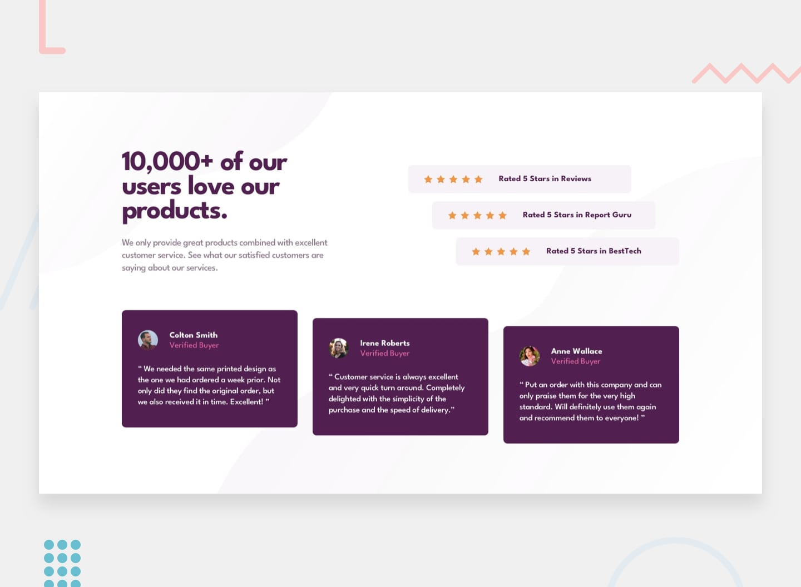

# Frontend Mentor - Social proof section solution

This is a solution to the [Social proof section challenge on Frontend Mentor](https://www.frontendmentor.io/challenges/social-proof-section-6e0qTv_bA). Frontend Mentor challenges help you improve your coding skills by building realistic projects. 

## Table of contents

- [Overview](#overview)
  - [The challenge](#the-challenge)
  - [Screenshot](#screenshot)
  - [Links](#links)
- [My process](#my-process)
  - [Built with](#built-with)
- [Author](#author)

## Overview

### The challenge

Users should be able to:

- View the optimal layout for the section depending on their device's screen size

### Screenshot

### Links

- Solution URL: [https://github.com/victoire20/social-proof-section](https://github.com/victoire20/social-proof-section)
- Live Site URL: [https://social-proof-section-frontenchallenge.netlify.app](https://social-proof-section-frontenchallenge.netlify.app)

## My process

### Built with

- Semantic HTML5 markup
- CSS custom properties
- Flexbox
- Mobile-first workflow

## Author

- Website - [https://portfolio-eight-dun-30.vercel.app](https://portfolio-eight-dun-30.vercel.app/)
- Frontend Mentor - [@victoire20](https://www.frontendmentor.io/profile/victoire20)

